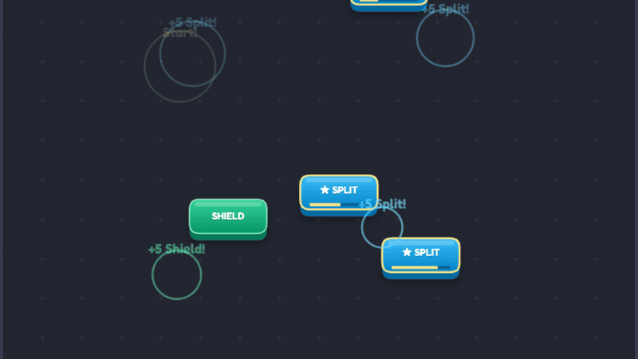

# Button Collision

**Button Collision** is an ultra-lightweight, zero-dependency HTML5 Canvas chain-reaction arcade game written in vanilla JavaScript.

**[Play Live on GitHub Pages](https://mk314k.github.io/buttonGame/)**



## Gameplay & Rules

1. **Start**: Tap anywhere on the board to launch your first **★ Magic Tile**.
2. **Phase Cycling**: Every Magic Tile cycles through **Sky Blue $\rightarrow$ Mint Green $\rightarrow$ Coral Red** with a live countdown bar along its bottom edge:
   - **`★ SPLIT` (Tap on Sky Blue, `+5 pts`)**: The Magic Tile splits into **two** cycling Magic Tiles moving in opposite directions!
   - **`SHIELD` (Tap on Mint Green, `+5 pts`)**: Locks permanently into a **Mint Shield** that bounces Magic Tiles safely and pops Coral Hazards for a **`+10 Shield Save!`** bonus.
   - **`HAZARD` (Tap on Coral Red, `+5 pts`)**: Locks permanently into a **Coral Hazard** that pops any Magic Tile it collides with.
3. **Scaling Pace & Round Over**: Board velocity scales smoothly with your score. The round ends when **0 Magic Tiles** remain on the board.

## Running Locally

```bash
git clone https://github.com/mk314k/buttonGame.git
cd buttonGame
npx serve .
```

## License

MIT License
